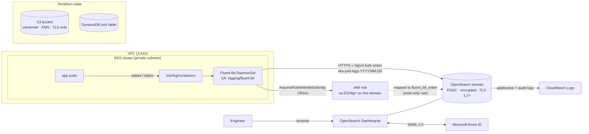

# EKS pod logs → Fluent Bit → Amazon OpenSearch (with SAML SSO)

[](https://github.com/18-ashish-sharma/aws-os-eks-logs-terraform/actions/workflows/terraform.yml)


Terraform that builds a VPC and an EKS cluster, ships every pod's logs with a
Fluent Bit DaemonSet to an Amazon OpenSearch Service domain, and lets people sign
in to OpenSearch Dashboards with SAML (Microsoft Entra ID). Fluent Bit writes with
its own IAM role (IRSA), so there is no password in Helm values or Kubernetes.

## Architecture



## Repository layout

```text
.
├── module/                          # reusable child modules (no provider config)
│   ├── eks-cluster/                 # EKS (terraform-aws-modules/eks v21), node group, VPC CNI IRSA, access entries
│   ├── opensearch/                  # aws_opensearch_domain, FGAC, logs, access policy, SAML, custom endpoint
│   └── remote-state/                # S3 state bucket + DynamoDB lock table
├── terraform/
│   └── staging/                     # one directory per environment (blast radius + own backend)
│       ├── remote-state/            # bootstrap stack: creates the backend for this environment
│       └── base-infra/              # VPC + EKS + OpenSearch + Fluent Bit (IRSA + Helm)
│           ├── backend.tf.example
│           ├── example.tfvars
│           └── fluent-bit.tf
├── .github/workflows/terraform.yml  # fmt, validate, tflint, checkov (SARIF); no cloud credentials
├── .pre-commit-config.yaml
└── .tflint.hcl
```

## Prerequisites

- Terraform `>= 1.10`, AWS CLI v2 (the Helm provider calls `aws eks get-token`), `kubectl`
- AWS credentials that can create VPC, EKS, IAM, OpenSearch, S3 and DynamoDB resources
- For SAML: an Entra ID tenant where you can create an Enterprise application

## How to run

```bash
# 1. Bootstrap the state backend (local state, once per environment)
cd terraform/staging/remote-state
terraform init
terraform apply -var-file=example.tfvars          # edit bucket_name first: S3 names are global
terraform output -raw backend_config              # paste into ../base-infra/backend.tf

# 2. Base infrastructure
cd ../base-infra
cp backend.tf.example backend.tf                  # or paste the output above
cp example.tfvars staging.tfvars                  # *.tfvars are git-ignored, except example.tfvars
terraform init
terraform workspace show                          # "default" -> env comes from var.env ("staging")
terraform plan -var-file=staging.tfvars -out=staging.tfplan
terraform apply staging.tfplan

aws eks update-kubeconfig --region ap-south-1 --name eks-logs-staging
kubectl -n logging get ds
```

### Workspaces

Directories separate **environments** (staging, prod): each has its own backend,
can live in its own account, and a mistake in one cannot touch the other.
Workspaces give cheap **parallel copies inside one environment**, e.g. to test a
change without touching the shared staging stack:

```bash
terraform workspace new stg-pr42           # resources become eks-logs-stg-pr42*
terraform apply -var-file=staging.tfvars
terraform destroy -var-file=staging.tfvars
terraform workspace select default && terraform workspace delete stg-pr42
```

`local.env` is the workspace name (or `var.env` in `default`). It is part of
every resource name and of the `Workspace` tag, and the S3 backend stores each
workspace's state under `env:/<workspace>/base-infra/terraform.tfstate`.
Keep workspace names short: the OpenSearch domain name (`<project>-<env>`) is
limited to 28 characters, and a precondition stops the plan if it is too long.

### State locking

The backend locks with the DynamoDB table. Terraform 1.10+ can also lock with
S3 alone (`use_lockfile = true`, see `backend.tf.example`); the table is kept so
older CLIs still lock correctly.

## SAML sign-in with Microsoft Entra ID

1. **Apply once without SAML** (`saml_enabled = false`). Note the outputs
   `saml_sp_entity_id` and `saml_acs_url`.
2. **Create the app**: Entra ID → Enterprise applications → New application →
   *Create your own application* (non-gallery), e.g. "OpenSearch Dashboards".
3. **Single sign-on → SAML**: set *Identifier (Entity ID)* = `saml_sp_entity_id`
   and *Reply URL (ACS)* = `saml_acs_url`.
4. **Attributes & Claims → Add a group claim** (security groups, Group ID), so
   group object IDs arrive in the
   `http://schemas.microsoft.com/ws/2008/06/identity/claims/groups` attribute.
5. **Users and groups**: assign the groups that may use Dashboards.
6. **Download Federation Metadata XML** and note the *Microsoft Entra Identifier*.
7. **Apply again with SAML** in your tfvars:
   ```hcl
   saml_enabled             = true
   saml_idp_entity_id       = "https://sts.windows.net/<tenant-id>/"
   saml_idp_metadata_path   = "./entra-federation-metadata.xml"
   saml_master_backend_role = "<object id of the admin group>"
   ```
8. **Map other groups to roles**: members of the admin group sign in, open
   *Security → Roles* in Dashboards and map other group IDs as *backend roles*
   (e.g. a read-only group to `readall` and `opensearch_dashboards_read_only`).

The internal master user stays as break-glass access:
`terraform output -raw opensearch_master_password`.

## Security notes

- **Least-privilege IAM.** Fluent Bit's role can only be assumed by the
  `logging/fluent-bit` service account (IRSA trust on `sub` and `aud`), may only
  call `es:ESHttp{Get,Head,Post,Put}` on this domain, and inside OpenSearch is
  mapped to `fluent_bit_writer`: create and write `eks-pod-logs-*` indices only.
  The VPC CNI has its own IRSA role too, so the node role does not carry the CNI policy.
- **Cluster access** uses EKS access entries (no `aws-auth` ConfigMap). Admin roles
  are an input (`cluster_admin_role_arns`); none are hard-coded.
- **Encryption.** OpenSearch: at rest, node-to-node, HTTPS enforced with
  `Policy-Min-TLS-1-2-PFS-2023-10`. EKS: Kubernetes secrets encrypted with a KMS key
  (module default), node EBS volumes encrypted, IMDSv2 required. State: S3 SSE-KMS
  and a TLS-only bucket policy; DynamoDB encrypted with point-in-time recovery.
- **Fine-grained access control** on OpenSearch: anonymous access off, every
  request authenticated (SigV4, SAML or the internal master user) and authorised
  per role. Application and audit logs go to CloudWatch.
- **Secrets in state.** The OpenSearch master password is generated by
  `random_password`, so it *is* in Terraform state (marked `sensitive`, which only
  hides it from CLI output). That is why the state bucket is private, versioned,
  encrypted and TLS-only; restrict access to it to the people and pipelines that
  run Terraform.
- **Public endpoints, on purpose.** The OpenSearch domain is public so browsers
  can reach Dashboards over SAML; the EKS API is public but limited by
  `eks_public_access_cidrs`. For production, put the domain in the VPC and reach
  Dashboards through a VPN or proxy.
- **CI** runs fmt, validate, tflint and checkov with `contents: read` only, no
  cloud credentials and no `apply`. Checkov results go to GitHub code scanning.
  Every intentional checkov skip is inline, next to the code, with its reason.

## Cost notes

- **OpenSearch is the largest line item.** Staging defaults: 2 × `m6g.large.search`
  (Graviton), 100 GiB gp3 each, **no dedicated masters**. Turn on
  `opensearch_dedicated_master_enabled` for production.
- **Retention drives storage.** Daily indices (`eks-pod-logs-YYYY.MM.DD`) make
  retention a cheap index delete; add an ISM policy to delete (or move to
  UltraWarm) after N days.
- **EKS nodes** are Graviton on **Spot**, with two instance types for capacity.
- **One NAT gateway** (`single_nat_gateway = true`) instead of one per AZ.
- **Kubernetes version**: stay in EKS standard support; extended support bills the
  control plane at a higher hourly rate.
- **CloudWatch**: the chart's default CloudWatch output is off (logs go to OpenSearch
  only); control-plane and domain logs are kept 30 days by default.

## Design decisions

| Decision | Why |
| --- | --- |
| Plain `aws_opensearch_domain` instead of a community wrapper | Every security setting is visible in one file and easy to review. |
| IRSA + SigV4 for Fluent Bit (`awsAuth: On`) | No shared password; access is scoped to one service account, one domain and one index pattern. |
| EKS access entries instead of `aws-auth` | AWS-managed API, no ConfigMap to bootstrap or break. |
| Daily indices (`logstashFormat: On`) + `replaceDots: On` | Simple retention; Kubernetes label keys with dots don't cause mapping conflicts. |
| Directory per environment, workspaces inside it | Directories isolate backends and accounts; workspaces give short-lived copies. |
| Exact versions for registry modules, `~>` for providers, committed lock files | Reproducible plans; upgrades are a reviewed change. |

## Inputs and outputs

Generated with `terraform-docs`. Module references:
[`module/eks-cluster`](module/eks-cluster/README.md) ·
[`module/opensearch`](module/opensearch/README.md) ·
[`module/remote-state`](module/remote-state/README.md) ·
[`terraform/staging/remote-state`](terraform/staging/remote-state/README.md)

### `terraform/staging/base-infra`

<!-- BEGIN_TF_DOCS -->
### Requirements

| Name | Version |
| ---- | ------- |
| terraform | >= 1.10.0, < 2.0.0 |
| aws | ~> 6.0 |
| helm | ~> 3.0 |
| opensearch | ~> 2.3 |
| random | ~> 3.7 |

### Providers

| Name | Version |
| ---- | ------- |
| aws | 6.72.0 |
| helm | 3.3.0 |
| opensearch | 2.6.0 |

### Modules

| Name | Source | Version |
| ---- | ------ | ------- |
| eks | ../../../module/eks-cluster | n/a |
| opensearch\_logging | ../../../module/opensearch | n/a |
| vpc | terraform-aws-modules/vpc/aws | 6.7.3 |

### Resources

| Name | Type |
| ---- | ---- |
| [aws_iam_role.fluent_bit](https://registry.terraform.io/providers/hashicorp/aws/latest/docs/resources/iam_role) | resource |
| [aws_iam_role_policy.fluent_bit_opensearch](https://registry.terraform.io/providers/hashicorp/aws/latest/docs/resources/iam_role_policy) | resource |
| [helm_release.fluent_bit](https://registry.terraform.io/providers/hashicorp/helm/latest/docs/resources/release) | resource |
| [opensearch_role.fluent_bit](https://registry.terraform.io/providers/opensearch-project/opensearch/latest/docs/resources/role) | resource |
| [opensearch_roles_mapping.fluent_bit](https://registry.terraform.io/providers/opensearch-project/opensearch/latest/docs/resources/roles_mapping) | resource |
| [aws_availability_zones.available](https://registry.terraform.io/providers/hashicorp/aws/latest/docs/data-sources/availability_zones) | data source |
| [aws_iam_policy_document.fluent_bit_assume](https://registry.terraform.io/providers/hashicorp/aws/latest/docs/data-sources/iam_policy_document) | data source |
| [aws_iam_policy_document.fluent_bit_opensearch](https://registry.terraform.io/providers/hashicorp/aws/latest/docs/data-sources/iam_policy_document) | data source |

### Inputs

| Name | Description | Type | Default | Required |
| ---- | ----------- | ---- | ------- | :------: |
| cluster\_admin\_role\_arns | IAM role ARNs (e.g. an SSO admin role) given cluster-admin via EKS access entries. | `list(string)` | `[]` | no |
| eks\_desired\_size | Desired number of worker nodes at creation. | `number` | `2` | no |
| eks\_instance\_types | Graviton (ARM) instance types for the managed node group. | `list(string)` | <pre>[<br/>  "t4g.large",<br/>  "m6g.large"<br/>]</pre> | no |
| eks\_log\_retention\_days | Retention, in days, for EKS control-plane logs in CloudWatch. | `number` | `30` | no |
| eks\_max\_size | Maximum number of worker nodes. | `number` | `3` | no |
| eks\_min\_size | Minimum number of worker nodes. | `number` | `2` | no |
| eks\_public\_access\_cidrs | CIDR blocks allowed to reach the public EKS API endpoint. | `list(string)` | <pre>[<br/>  "0.0.0.0/0"<br/>]</pre> | no |
| eks\_use\_spot\_instances | Run the node group on Spot capacity. | `bool` | `true` | no |
| env | Environment name used when the Terraform workspace is "default". In any other workspace, the workspace name is used instead. | `string` | `"staging"` | no |
| fluent\_bit\_chart\_version | Version of the aws-for-fluent-bit Helm chart. | `string` | `"0.1.35"` | no |
| kubernetes\_version | EKS Kubernetes version. Keep it in standard support to avoid extended-support charges. | `string` | `"1.34"` | no |
| log\_index\_prefix | Prefix of the daily pod-log indices (<prefix>-YYYY.MM.DD). | `string` | `"eks-pod-logs"` | no |
| opensearch\_custom\_endpoint | Optional custom hostname for the domain, e.g. logging.example.com. | `string` | `null` | no |
| opensearch\_custom\_endpoint\_certificate\_arn | ACM certificate ARN for opensearch\_custom\_endpoint. | `string` | `null` | no |
| opensearch\_dedicated\_master\_enabled | Run three dedicated master nodes (recommended for production). | `bool` | `false` | no |
| opensearch\_dedicated\_master\_type | Instance type for dedicated master nodes. | `string` | `"c6g.large.search"` | no |
| opensearch\_engine\_version | OpenSearch engine version. | `string` | `"OpenSearch_2.11"` | no |
| opensearch\_instance\_count | Number of OpenSearch data nodes (1, or an even number for two AZs). | `number` | `2` | no |
| opensearch\_instance\_type | OpenSearch data node instance type. | `string` | `"m6g.large.search"` | no |
| opensearch\_log\_retention\_days | Retention, in days, for the OpenSearch domain's own application/audit logs in CloudWatch. | `number` | `30` | no |
| opensearch\_volume\_size | EBS volume size per OpenSearch data node, in GiB. | `number` | `100` | no |
| opensearch\_volume\_type | EBS volume type for OpenSearch data nodes. | `string` | `"gp3"` | no |
| project | Short project name; prefix for the VPC, EKS cluster and OpenSearch domain (<project>-<env>). | `string` | `"eks-logs"` | no |
| region | AWS region for every resource in this stack. | `string` | `"ap-south-1"` | no |
| route53\_zone\_id | Route 53 hosted zone ID for the custom endpoint CNAME. | `string` | `null` | no |
| saml\_enabled | Enable SAML login for OpenSearch Dashboards. Requires the three saml\_* inputs below. | `bool` | `false` | no |
| saml\_idp\_entity\_id | IdP entity ID (Entra ID: "Microsoft Entra Identifier", e.g. https://sts.windows.net/<tenant-id>/). | `string` | `null` | no |
| saml\_idp\_metadata\_path | Path to the IdP federation metadata XML file downloaded from Entra ID. | `string` | `null` | no |
| saml\_master\_backend\_role | Entra ID group object ID whose members become OpenSearch admins. | `string` | `null` | no |
| single\_nat\_gateway | Use one NAT gateway for all AZs (cheaper) instead of one per AZ (survives an AZ outage). | `bool` | `true` | no |
| vpc\_cidr | CIDR block of the VPC. Private subnets take /20s from the start, public subnets /24s higher up. | `string` | `"10.20.0.0/16"` | no |

### Outputs

| Name | Description |
| ---- | ----------- |
| configure\_kubectl | Command that writes a kubeconfig entry for the cluster. |
| eks\_cluster\_endpoint | Kubernetes API endpoint. |
| eks\_cluster\_name | Name of the EKS cluster. |
| environment | Environment this state describes (workspace name, or var.env in the default workspace). |
| fluent\_bit\_role\_arn | IAM role assumed by Fluent Bit through IRSA and mapped to the fluent\_bit\_writer OpenSearch role. |
| opensearch\_dashboards\_url | OpenSearch Dashboards URL. |
| opensearch\_endpoint | OpenSearch domain endpoint (HTTPS). |
| opensearch\_master\_password | OpenSearch internal master password (break-glass). Read with: terraform output -raw opensearch\_master\_password |
| opensearch\_master\_username | OpenSearch internal master user (break-glass). |
| saml\_acs\_url | Enter in Entra ID as Reply URL (Assertion Consumer Service URL). |
| saml\_sp\_entity\_id | Enter in Entra ID as Identifier (Entity ID). |
| vpc\_id | ID of the VPC. |
<!-- END_TF_DOCS -->
